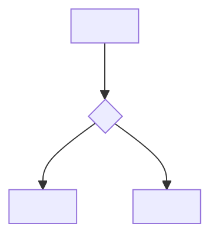

# <Module> Workflows

> <One line: what the core flow of this module is.>

## L1 · Overview (human-first: grasp the main path in 5 min)

### End-to-End Flow
<Complex / multi-branch → Mermaid flowchart; simple linear flow → ASCII arrow chain. Render the diagram where it renders (Lark/web); **do not also write a prose "text fallback" restating the diagram** (it duplicates the L2 numbered steps) — the main path is carried by the L2 steps.>

### Key States
| State | Meaning | Entry condition | UI/behavior |
|---|---|---|---|

## L2 · Core Flow Details (AI + deep read)
<One section per flow, 2-4 is ideal. Add a sequenceDiagram only for multi-component async interactions.>

### 2.1 <Flow Name>
<One line on when it triggers.>
1. **<step>** — <what it does> (`<Class.method>`)
2. **<step>** — <what it does>

**Conditions & boundaries:**
| Condition | Handling | Output/consequence |
|---|---|---|
| <abnormal input> | <how handled> | <result> |

### 2.2 <Flow Name>
<Same structure as above.>

## L3 · Failure & Degradation (REQUIRED — not only the happy path)
| Scenario | Cause | Handling/degradation | User-visible effect |
|---|---|---|---|
| <network fail/timeout/missing data…> | | | |

<Performance-critical points / main tracking events (if any), 1-3 lines each.>
